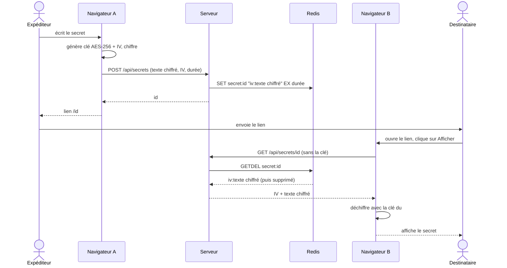
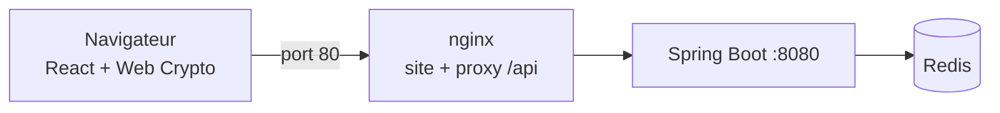

# Sealed

Partage de secrets à usage unique. Le texte est chiffré **dans le navigateur** avant d'être envoyé : le serveur ne voit jamais le secret en clair, ni la clé. Le lien généré ne fonctionne qu'une seule fois.

## Comment ça marche



- La clé est placée après le `#` du lien : le navigateur ne l'envoie jamais au serveur.
- `GETDEL` lit et supprime en une seule opération Redis : un second accès donne une erreur 404, même si deux personnes ouvrent le lien en même temps.
- La lecture se fait au clic sur un bouton, donc un rechargement ou un aperçu du lien ne consomme pas le secret.

## Architecture



nginx sert le site et transmet `/api/` au backend (pas de CORS à configurer). Il écrase `X-Forwarded-For` avec l'IP réelle du client pour que la limite de requêtes ne soit pas contournable. Le backend n'est pas accessible depuis l'extérieur, et Redis seulement depuis `127.0.0.1`.

Le backend suit la structure Spring classique : `controller`, `service`, `repository`, `dto`, `config`.

**Technologies :** Java 17, Spring Boot 3.3.5, Redis 7.4, React 18, Vite 5, Web Crypto API, JUnit 5, Mockito, Docker Compose, nginx.

## Lancer le projet

Avec Docker Desktop, depuis la racine :

```bash
docker compose up --build -d
```

Puis ouvrir http://localhost. Pour arrêter : `docker compose down`.

En développement :

```bash
docker compose up -d redis
cd backend && mvn spring-boot:run
cd frontend && npm install && npm run dev
```

Le site est alors sur http://localhost:5173 (Vite redirige `/api` vers le port 8080).

## API

| Méthode | URL | Réponses |
|---|---|---|
| POST | `/api/secrets` | 201 `{ "id": "..." }`, 400, 429 |
| GET | `/api/secrets/{id}` | 200 `{ "iv": "...", "ciphertext": "..." }`, 404, 429 |

Corps du POST : `{ "ciphertext": "...", "iv": "...", "ttlSeconds": 3600 }`

- `ciphertext` en base64url, 100 000 caractères au maximum (environ 74 000 octets de texte clair) ;
- `ttlSeconds` entre 60 secondes et 7 jours ;
- la lecture répond avec `Cache-Control: no-store` ;
- limite de **20 requêtes par minute et par IP** (compteur Redis), sinon 429 avec `Retry-After`.

## Tests

Les tests ont besoin de Redis :

```bash
docker compose up -d redis
cd backend && mvn test
```

Ils couvrent le service (Mockito), le contrôleur (codes HTTP, validation, `no-store`), le repository (lecture unique, lectures simultanées, avec un vrai Redis) et la limite de requêtes.

## Limites connues

- Quiconque a le lien complet peut lire le secret une fois : il faut l'envoyer par un canal de confiance.
- Si une panne survient entre la création du compteur de requêtes et sa date d'expiration, l'IP concernée pourrait rester bloquée. Le cas est très rare, donc je ne l'ai pas traité.